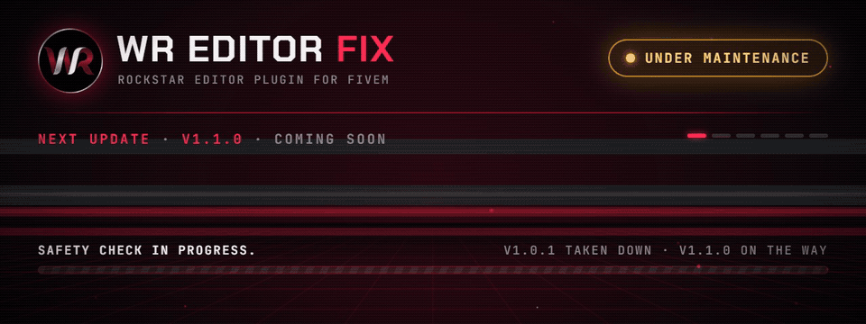

<!-- MADE BY WR | WARRAA_ -->
# WR Editor Fix

> [!IMPORTANT]
> **Under maintenance.** WR Editor Fix is going through a full safety check. Downloads are paused until v1.1.0 is ready.

## Status

| | |
|---|---|
| **Downloads** | Paused |
| **v1.0.1** | Taken down |
| **v1.1.0** | In development, coming soon |

## Why is it down?

WR Editor Fix is a FiveM `.asi` plugin for the Rockstar Editor. To make sure it fully follows the rules for `.asi` plugins on FiveM, it is being reworked from the ground up. Until that work is finished and checked, no version is available for download.

## Already using it?

| Your version | What to do |
|---|---|
| **v1.0.0 or older** | Remove it now. |
| **v1.0.1** | Safer than everything before it, but it was made before this safety check. Use at your own risk; removing it until v1.1.0 is recommended. |

**How to remove it:** close FiveM, open `%localappdata%\FiveM\FiveM.app\plugins` and delete `WR_Editor_Fix.asi`.
Your settings, presets and projects in the `WR Editor Fix` folder can stay. v1.1.0 uses the same folder.

## Coming in v1.1.0

**Safety-first rebuild**
- Never hooks, patches or calls FiveM's own code
- By default its game changes only switch on inside the Rockstar Editor, nothing changes when the game starts
- Switches itself off the moment you join a server

**And on top of that**
- More features
- More fixes
- Reworked tools
- A smoother experience
- Easier to use and understand

## Stay updated

The v1.1.0 release will be announced on Discord and here on GitHub.

[Discord](https://discord.com/invite/FKJ27bhqfJ) · [YouTube](https://www.youtube.com/@Warraa__)
